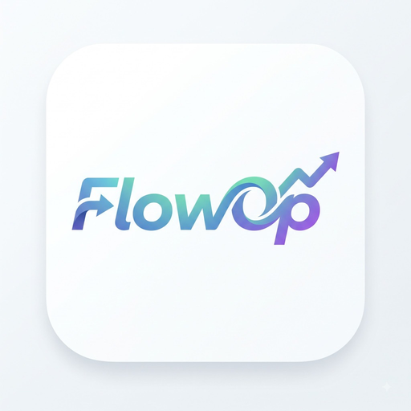

# Flow Ecosystem (FlowS, FlowOptimize & FlowUltra) 🚀
### eSports Gaming Optimizer & Advanced Hardware Suite for Android (100% No Root via Shizuku)

> **Flow Ecosystem** là bộ ba công cụ tối ưu hóa phần cứng và gaming eSports chuyên sâu dành cho thiết bị Android, kết hợp tinh hoa từ **Gamer GLTool**, **Magic Tuner**, **Appzuku Greedy Restrictor** và **Flowly Engine**. Hoạt động hoàn toàn qua đặc quyền **Shizuku ADB** (Không cần Root máy).

---

## 🌟 Bộ Ba Ứng Dụng (Apps Overview)

### 1. ⚡ FlowS - Gamer Tuner (v3.5.0 Pro)
- **Tự Động Quét Game Thật**: Nhận diện Liên Quân, Free Fire, PUBG Mobile, Tốc Chiến, Roblox...
- **Hạ Độ Phân Giải Riêng Từng Game**: Tùy chỉnh 540p / 720p tăng 25-35 FPS mượt mà, máy luôn mát lạnh.
- **Auto-Restore Độc Quyền**: Tự động hoàn trả độ phân giải gốc khi khóa màn hình hoặc thoát game.
- **Chế Độ CRAZY Đầu 3x**: Dồn RAM trống ~3200MB, khóa tần số quét 120Hz chống tụt khung hình.
- **Sửa Thanh Pin ColorOS/RealmeUI**: Nút 1-chạm hoàn trả thanh pin trắng nguyên bản 100%.

### 2. 🌸 FlowOptimize - Anime Edition (v2.6.0 Pro)
- **7 Bộ Theme Anime Độc Quyền**: Kimi no Na wa (Your Name), Gojo Satoru, Naruto, One Piece, Conan, Dragon Ball Super.
- **Chẩn Đoán Bóp Xung Theo Hãng**: Xiaomi Joyose, Samsung GOS, Oppo/Realme, Vivo, Infinix.
- **Bong Bóng Nổi HUD (Floating Overlay)**: Giám sát RAM, CPU, nhiệt độ trực tiếp trong lúc chơi game.
- **Bảo Vệ Đa Nhiệm Thông Minh**: Dọn RAM sạch sẽ nhưng bảo vệ 100% cuộc gọi Zalo, Messenger không bị văng.

### 3. 🚀 FlowUltra - Open-Source Hardware Suite (v1.0.5 Pro)
- **Shappky 4-Stage Progressive Killer**: Diệt tận gốc tiến trình cứng đầu pkill -9.
- **Appzuku Greedy Restrictor**: Khóa AppOps WakeLock chạy ngầm TikTok, Facebook, Shopee.
- **Screen-Off Deep Doze**: Ép CPU ngủ sâu force-idle khi tắt màn hình, pin đêm tụt < 1%.
- **AFK Extinguish 0-Nits**: Tắt màn hình AMOLED về 0-nits để cày game / treo máy không hao pin và chống chai màn hình.
- **MemHogs Live PSS Tracker & Hail**: Đo RAM PSS chính xác & đóng băng ứng dụng rác 0% CPU.

---

## 📥 Tải Về & Cài Đặt (Download APKs)

| Ứng Dụng | Phiên Bản | Đặc Quyền | Link Tải Trực Tiếp (Vượt Link4M) |
|---|---|---|---|
| **FlowS - Gamer Tuner** | v3.5.0 Pro | Shizuku (No Root) | [Tải FlowS APK (Link4M)](https://link4m.co/st?api=6ae77b1c1473a714b32b2a3a&url=https%3A//gofile.io/d/z3wUcYxV) |
| **FlowOptimize - Anime Edition** | v2.6.0 Pro | Shizuku (No Root) | [Tải FlowOptimize APK (Link4M)](https://link4m.co/st?api=6ae77b1c1473a714b32b2a3a&url=https%3A//gofile.io/d/ZUqi1crJ) |
| **FlowUltra - Hardware Suite** | v1.0.5 Pro | Shizuku (No Root) | [Tải FlowUltra APK (Link4M)](https://link4m.co/st?api=6ae77b1c1473a714b32b2a3a&url=https%3A//gofile.io/d/HqxIEJbn) |

---

## 🌐 Hướng Dẫn Triển Khai Lên GitHub Pages
Để xem web preview trực tiếp trên GitHub:
1. Đẩy toàn bộ các file trong thư mục này lên repository GitHub của bạn (ví dụ: `FlowOptimize_Web` hoặc `Upload_Len_GitHub_Bio`).
2. Vào **Settings** của repository > **Pages** > chọn nhánh `main` (hoặc `master`), thư mục root `/`.
3. Bấm **Save**, sau 1-2 phút bạn sẽ có link web trực tuyến:
   - `index.html`: Giao diện Web Bio chính thức với bộ 3 nút mở khóa TikTok & vượt link tải 3 app.
   - `bio.html`: Trang liên kết Bio gọn đẹp dành cho TikTok / Bio Link.
   - `showcase.html`: Tài liệu phân tích kỹ thuật và bảng tính DPI.

---

## 👤 Kênh Chính Thức & Bản Quyền
- Kênh TikTok chính thức: [@xxd5974](https://www.tiktok.com/@xxd5974)
- Kênh Telegram: [Flow Ecosystem Community](https://t.me/+dtVBEzwuN2Q4NmI9)
- Flowly Gaming Engine © 2026. All rights reserved.
